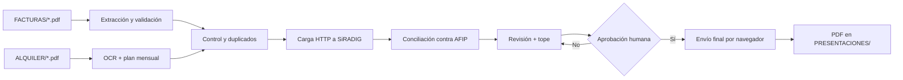

# PagosAFIP

Automatización para cargar **facturas de servicios y equipamiento** y **alquileres de casa habitación**
en **SiRADIG** (Impuesto a las Ganancias, 4.ª categoría), revisar los totales, enviar la
rectificativa al empleador y guardar el PDF de la presentación.

El proyecto combina **scripts deterministas en Python** con **agentes y skills de OpenCode**
que orquestan el trabajo con un humano en el loop.

> **Repositorio público y sanitizado.** No contiene facturas, contratos, credenciales,
> CUITs, nombres, direcciones, importes ni presentaciones reales. Los ejemplos usan datos
> ficticios. Los datos locales se excluyen con `.gitignore`.

---

## Qué hace

- **Facturas**: lee los PDF de `FACTURAS/`, extrae CUIT emisor, tipo, punto de venta,
  número, fecha, total y CAE; valida CUIT y montos; detecta duplicados; deja un JSON y un
  CSV; carga los comprobantes en SiRADIG por HTTP; concilia contra AFIP.
- **Alquileres**: lee contratos escaneados de `ALQUILER/` con OCR, arma el plan mensual,
  calcula el 40% deducible, asigna números de factura, carga por HTTP, verifica y permite
  actualizar meses futuros sin duplicar.
- **Rectificativa**: combina equipamiento + alquiler, mide el tope de carga directa, pide
  aprobación explícita con el total y envía una sola presentación.
- **Histórico**: descarga el PDF de la última presentación a `PRESENTACIONES/` y lo abre.
- **Calidad**: linter, validación de skills, evaluaciones de disparo, ruteo real y casos de
  comportamiento de agentes.

---

## Principios

1. **HTTP primero.** El navegador (Playwright) es el último recurso. La única excepción
   verificada es el envío final de la rectificativa, que usa el diálogo de la web.
2. **Humano en el loop.** El envío no tiene vuelta atrás: sólo se hace con aprobación
   explícita del usuario en el mismo turno y con el total exacto.
3. **Maker-checker.** Un subagente verificador de solo lectura revisa la conciliación, los
   totales y el tope antes de enviar. Si no da `VEREDICTO: OK`, no se envía.
4. **Mínimo privilegio.** `credenciales.env` no se lee ni se muestra. Los logs y el registro
   de red redactan claves, tokens, cookies y firmas.
5. **No afirmar sin verificar.** Que un script termine sin error no significa que la carga
   esté bien: se concilia contra AFIP.
6. **Ante un error, parar.** Se mira el registro, se diagnostica y se reintenta como máximo
   dos veces el mismo paso.

---

## Arquitectura



- **Carga, consulta, conciliación, Vista Previa y PDF histórico**: HTTP.
- **Envío final**: navegador, porque el diálogo de confirmación de AFIP es el camino
  verificado. Si el HTTP falla en otro paso, se diagnostica antes de abrir el navegador.

---

## Requisitos

- macOS o Linux.
- Python **3.12**.
- Homebrew (para OCR).
- Chromium de Playwright (respaldo y envío final).
- Bun o Node sólo si se usa el MCP de Playwright de OpenCode.

### Instalación

```sh
git clone https://github.com/TU_USUARIO/pagosafip-automation.git
cd pagosafip-automation

python3.12 -m venv .venv
source .venv/bin/activate
pip install -r requirements.txt
playwright install chromium

# OCR para contratos escaneados
brew install tesseract tesseract-lang poppler
```

---

## Configuración

### Credenciales

Copiá el ejemplo y completá tus datos:

```sh
cp credenciales.env.example credenciales.env
chmod 600 credenciales.env
```

```dotenv
AFIP_URL=https://auth.afip.gob.ar/contribuyente_/login.xhtml
AFIP_USUARIO=TU_CUIT
AFIP_PASSWORD=TU_CLAVE
```

`credenciales.env` está en `.gitignore`. **Nunca lo subas al repositorio.**

### Carpetas de datos

```text
FACTURAS/        PDFs de facturas (excluido del repo)
ALQUILER/        PDFs de contratos de alquiler (excluido del repo)
PRESENTACIONES/  PDFs de presentaciones enviadas (excluido del repo)
output/          JSON, logs, evidencia y control (excluido del repo)
```

El repositorio sólo conserva `.gitkeep` en esas carpetas para que existan.

---

## Uso rápido

### 1. Preflight

```sh
./.venv/bin/python scripts/pipeline.py preflight --sin-login
```

Verifica Python, dependencias, credenciales, carpetas, tests de montos, OCR (si hay
contratos) y, sin `--sin-login`, el login HTTP a AFIP.

### 2. Facturas

```sh
./.venv/bin/python scripts/pipeline.py extraer
./.venv/bin/python scripts/pipeline.py cargar
./.venv/bin/python scripts/pipeline.py conciliar
./.venv/bin/python scripts/pipeline.py revision
./.venv/bin/python scripts/tope_medir.py
```

- `extraer` deja `output/facturas.json` y `output/extracto.csv`.
- Sólo se cargan los comprobantes con estado `listo`.
- `revisar`, `duplicado`, `excluido` y `error` requieren decisión humana.
- `cargar` es idempotente: omite lo que ya está en AFIP.
- `revision` genera `output/revision_final.md`.
- `tope_medir` mide el tope de carga directa **sin enviar**.

### 3. Alquileres

```sh
./.venv/bin/python scripts/alquiler_ocr.py
./.venv/bin/python scripts/alquiler_actualizar.py --hasta 2026-10 --dry-run
./.venv/bin/python scripts/alquiler_cargar.py
./.venv/bin/python scripts/alquiler_verificar.py
./.venv/bin/python scripts/alquiler_historial.py --open
```

- `alquiler_ocr.py` usa caché por hash: si el contrato no cambió, no vuelve a OCR.
- `alquiler_actualizar.py` calcula meses faltantes según la regla del contrato.
- `alquiler_cargar.py` crea un registro por contrato o sólo por los meses pendientes.
- `alquiler_verificar.py` compara meses, montos, facturas y total contra AFIP.
- `alquiler_historial.py` descarga la última presentación a `PRESENTACIONES/`.

### 4. Pedidos mixtos

Si hay facturas y alquileres nuevos en el mismo pedido:

1. Preflight.
2. Extraer y cargar facturas.
3. Actualizar, cargar y verificar alquileres.
4. Conciliar, revisar y medir el tope.
5. Pedir **una sola aprobación** con el total combinado.
6. Enviar **una sola** rectificativa.

---

## Uso con OpenCode

El repositorio incluye `.opencode/agents/` y `.opencode/skills/`:

| Agente | Rol |
|---|---|
| `pagosafip-orquestador` | Agente principal: ejecuta el pipeline y pide las decisiones. |
| `pagosafip-verificador` | Subagente de solo lectura; valida antes de enviar. |
| `pagosafip-alquiler-especialista` | Carga y verifica alquileres; no envía. |
| `pagosafip-router-eval` | Sólo para pruebas de ruteo; no ejecuta acciones. |

| Skill | Uso |
|---|---|
| `pagosafip-preflight` | Entorno y dependencias. |
| `pagosafip-pdf-intake` | Extracción, validación y duplicados. |
| `pagosafip-siradig-http` | Contrato HTTP de SiRADIG. |
| `pagosafip-playwright` | Respaldo con navegador y envío final. |
| `pagosafip-validator` | Conciliación y control de totales. |
| `pagosafip-revision-final` | Informe, tope y aprobación. |
| `pagosafip-diagnostico` | Qué hacer cuando algo falla. |
| `pagosafip-observabilidad` | Logs y estado. |
| `pagosafip-alquiler` | Flujo completo de alquileres. |
| `pagosafip-skill-maintenance` | Crear y mejorar skills/agentes. |

### Ejemplos de pedidos

```text
Tengo más facturas en FACTURAS, cargalas a AFIP.
Estamos en diciembre, actualizá los alquileres de AFIP.
Tengo facturas nuevas y estamos en diciembre: cargá todo y prepará una sola rectificativa.
```

El agente ejecuta los scripts; el usuario no corre comandos. El navegador se usa sólo para
el envío final.

---

## Flujo de facturas

1. `pdf_extraer.py` lee cada PDF con `pdfplumber` y `dedupe_chars`.
2. Identifica el proveedor con `proveedores.py` o usa `extraer_generico`.
3. Valida CUIT (dígito verificador), fecha, tipo, punto de venta, número y monto.
4. Detecta duplicados por CUIT + punto de venta + número, y por CAE.
5. Estado por archivo:
   - `listo`: se carga.
   - `revisar`: falta un dato o el monto es ambiguo.
   - `duplicado`: mismo comprobante que otro archivo.
   - `excluido`: el usuario decidió no cargarlo.
   - `error`: no se pudo leer.
6. `siradig_cargar_lote.py` carga por HTTP. Un gasto por CUIT + mes + concepto; si ya
   existe, agrega el comprobante con `codigo`.
7. `siradig_conciliar.py` compara el lote contra AFIP.
8. `revision_final.py` arma el informe y `tope_medir.py` mide el tope.

### Montos

| Texto en el PDF | Monto | Regla |
|---|---|---|
| `83650.00` | 83650.00 | Sin coma: el punto es decimal si tiene 2 dígitos |
| `52.607,88` | 52607.88 | Con coma: la coma es decimal y el punto es miles |
| `1.234,56` | 1234.56 | Igual |
| `1,234.56` | 1234.56 | Formato inglés: el último separador es decimal |
| `1.500` | ambiguo | Va a `revisar`; no se adivina |

---

## Flujo de alquileres

1. `alquiler_ocr.py` lee contratos escaneados y cachea el texto por SHA-256.
2. Se completa `output/alquiler/control.json` con locador, inmobiliaria, vigencia, meses y
   facturas.
3. `alquiler_actualizar.py` extiende el plan hasta el mes pedido.
4. `alquiler_cargar.py` carga los meses pendientes por HTTP.
5. `alquiler_verificar.py` controla meses, montos, facturas y total.
6. `revision_final.py` suma equipamiento + alquiler.
7. `tope_medir.py` mide el tope.
8. Se envía una sola rectificativa con aprobación explícita.
9. `alquiler_marcar_enviado.py` pasa los registros a `enviado`.
10. `alquiler_historial.py --open` descarga y abre el PDF.

### Declaración `noTitular`

El formulario declara que el contribuyente **no es titular de ningún inmueble**. Es una
declaración legal. Si el usuario es titular de una casa, departamento, terreno, cochera o
cualquier inmueble, **no se debe tildar**. El script carga por HTTP, que no envía ese campo;
la decisión y el respaldo profesional son del usuario. El control registra la nota.

### Regla de aumento

El control puede guardar:

```json
{
  "alquiler_base": 700000,
  "mes_inicio": 3,
  "aumento_cada": 4,
  "aumento_porcentaje": 20
}
```

`alquiler_actualizar.py` calcula el importe de cada mes con esa regla. Si el contrato no
tiene los datos, se le preguntan al usuario.

---

## Control y estado

`output/alquiler/control.json` guarda, por contrato:

```json
{
  "archivo": "contrato-ejemplo.pdf",
  "locador": { "cuit": "30-00000000-0", "nombre": "LOCADOR DE EJEMPLO" },
  "inmobiliaria": { "cuit": "20-00000000-0", "nombre": "INMOBILIARIA DE EJEMPLO" },
  "vigencia": { "desde": "01/03/2026", "hasta": "28/02/2028" },
  "tipo_beneficio": "22",
  "registros": [
    { "registro_id": "000000000", "meses": [], "estado": "cargado" }
  ],
  "presentaciones": []
}
```

- `registros` cubre los meses ya cargados/enviados.
- `alquiler_cargar.py` sólo crea un registro con los meses que faltan.
- `alquiler_marcar_enviado.py` marca los registros después del envío.
- `output/envio.json` guarda el último envío y el historial.

### Guardia de duplicados

Si el total de la Vista Previa es igual al último enviado y no hay meses ni comprobantes
nuevos, el envío se bloquea y avisa “sin cambios”. Para forzar un reenvío excepcional:

```sh
FORZAR_ENVIO=1 ./.venv/bin/python scripts/siradig_enviar_ui.py 1.234.567,89
```

---

## Calidad y pruebas

```sh
./.venv/bin/python scripts/test_montos.py
./.venv/bin/python scripts/skill_lint.py
./.venv/bin/python scripts/routing_eval.py
```

- `test_montos.py`: conversión de montos y validez de CUIT.
- `skill_lint.py`: frontmatter, nombres, descripciones, 500 líneas, referencias, YAML y
  permisos de agentes.
- `routing_eval.py`: ejecuta pedidos reales y verifica qué skill carga OpenCode.
- `evals/triggers/*.json`: casos de disparo por skill.
- `evals/agents/*.json`: casos de comportamiento de agentes.

La validación estructural de skills se puede hacer con el plugin
[`opencode-skill-creator`](https://github.com/antongulin/opencode-skill-creator).

---

## Agregar un proveedor

1. Copiá el PDF a `FACTURAS/`.
2. Corré `pipeline.py extraer`.
3. Si queda en `revisar`, abrí el PDF y confirmá los datos.
4. Si el formato se repite, agregá una función en `scripts/proveedores.py`:

```python
def mi_proveedor(t):
    num = re.search(r"FACTURA\s+(\d{4})-(\d{8})", t)
    total = re.search(r"Total\s*\$?\s*([\d.,]+)", t)
    return {
        "emisor_cuit": "30000000007",
        "emisor_nombre": "MI PROVEEDOR",
        "tipo_afip": "6", "tipo_texto": "Factura B",
        "pv": num.group(1) if num else None,
        "numero": num.group(2) if num else None,
        "fecha": None,
        "total": total.group(1) if total else None,
    }
```

5. Agregalo a `PROVEEDORES` con su detector.
6. Volvé a correr `extraer` y compará con el PDF.

---

## Estructura del proyecto

```text
.
├── .opencode/
│   ├── agents/                 Agentes y subagentes
│   └── skills/                 Skills de OpenCode
├── evals/
│   ├── agents/                 Casos de comportamiento
│   ├── routing/                Ruteo entre skills
│   └── triggers/               Disparo por skill
├── scripts/
│   ├── afip_http.py            Login y sesión AFIP por HTTP
│   ├── alquiler_*.py           Flujo de alquileres
│   ├── pdf_extraer.py          Extracción de facturas
│   ├── proveedores.py          Registro de proveedores (plantillas)
│   ├── pipeline.py             Punto de entrada
│   ├── siradig_*.py            Contrato HTTP de SiRADIG
│   └── revision_final.py       Informe combinado
├── FACTURAS/                   Datos locales (ignorado)
├── ALQUILER/                   Datos locales (ignorado)
├── PRESENTACIONES/             PDFs locales (ignorado)
├── output/                     Estado local (ignorado)
├── AGENTS.md                   Instrucciones del proyecto
├── opencode.jsonc              Configuración de OpenCode
├── credenciales.env.example    Plantilla de credenciales
└── requirements.txt
```

---

## Seguridad y datos personales

- **Nunca** se suben `FACTURAS/`, `ALQUILER/`, `PRESENTACIONES/`, `output/`,
  `credenciales.env`, `.env`, logs, capturas ni PDFs.
- `.gitignore` bloquea esas rutas y los archivos `.pdf`, `.log` y `.jsonl`.
- Los scripts leen `credenciales.env` sin imprimirlo.
- Los logs y el registro de red redactan claves, tokens, cookies y firmas.
- El repositorio público es una plantilla sanitizada: los proveedores, CUITs e importes son
  ficticios.
- Antes de publicar cambios, corré:

```sh
grep -RIn -E "TU_CUIT|TU_CLAVE|NOMBRE|..." . --exclude-dir=.git
```

Más detalle en [`SECURITY.md`](SECURITY.md).

---

## Problemas frecuentes

| Síntoma | Qué hacer |
|---|---|
| El login falla | Revisar la clave en `credenciales.env`; no reintentar en bucle. Si hay captcha, usar el navegador visible. |
| Un PDF queda en `revisar` | Abrirlo, confirmar CUIT, fecha, número y total; completar `output/confirmados_manual.json`. |
| El OCR no lee un contrato | Probar 300 DPI; si sigue, leerlo visualmente y cargar los datos en el control. |
| La Vista Previa dice que supera el tope | No enviar. Medir con `tope_medir.py`; ofrecer carga no automática o quitar comprobantes con aprobación. |
| “Deducción de Alquiler de Inmuebles inválida o inexistente” | El registro ya fue enviado; no reintentar. Verificar con `alquiler_verificar.py` y el PDF histórico. |
| El envío dice “sin cambios” | Ya se envió ese total; si no hay meses/comprobantes nuevos, no corresponde otra rectificativa. |

---

## Aviso

Este proyecto **no está afiliado a AFIP/ARCA**. Automatiza un portal público con fines
personales. La información fiscal y la declaración jurada son responsabilidad del
contribuyente y de su contador. Verificá siempre los datos antes de enviar.

## Licencia

MIT. Ver [`LICENSE`](LICENSE).
